# Charon

[](https://github.com/Lomchat/charon/actions/workflows/ci.yml)
[](./LICENSE)
[](https://nodejs.org)
[](https://www.python.org)
[](https://nextjs.org)

> **One browser tab to run AI coding sessions — and read, edit, commit and
> ship what they write — across all your remote servers.** Charon is a
> self-hosted hub with three halves:
>
> 1. **A coding-agent hub** — [Claude Code](https://docs.claude.com/en/docs/claude-code)
>    ([Agent SDK](https://docs.claude.com/en/docs/claude-code/sdk)),
>    [OpenAI Codex](https://github.com/openai/codex) and Cursor sessions side by
>    side on any SSH-reachable VPS.
> 2. **A small IDE over SSH** — tabs, a file explorer, a conflict-safe editor,
>    language servers and source control.
> 3. **A persistent shell manager** — xterm.js terminals that survive hub,
>    agent and browser restarts.

Sessions, file access and shells live in one daemon (`charon-agent`) per VPS,
so they keep running when your laptop sleeps, your network drops or you restart
the hub. Charon is only the control plane.

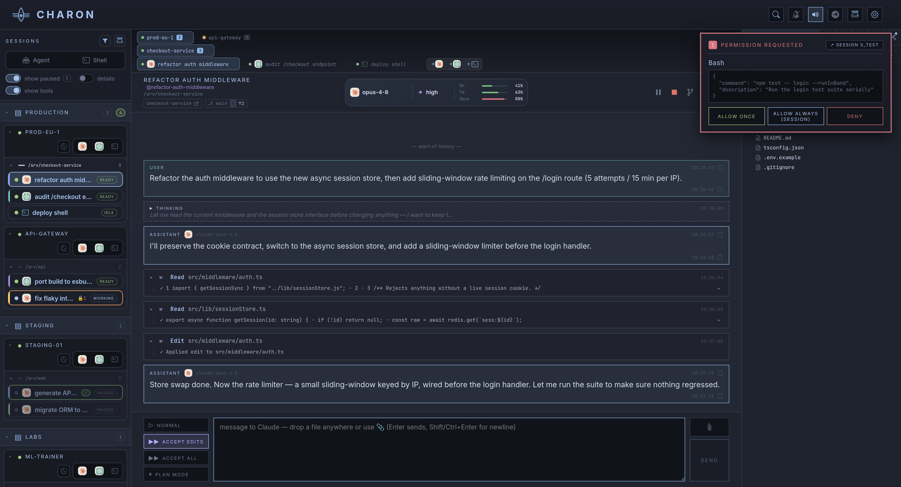

```
┌───────────────┐  HTTPS/SSE   ┌────────────────────────┐  SSH (1 per VPS)  ┌──────────────────────┐
│   Browser     │ ◄──────────► │  Charon (Next.js)      │ ◄───────────────► │  charon-agent (VPS)  │
│  sessions +   │  SSE / POST  │  - 1 SSH per VPS       │  exec: pyz        │  - asyncio Unix sock │
│  files +      │              │  - JSON-RPC multiplex  │  --connect proxy  │  - N SDK sessions    │
│  shells       │              │  - SQLite (charon.db)  │  stdio↔socket     │  - files · git       │
│  (1 tab)      │              │                        │                   │  - detached shells   │
└───────────────┘              └────────────────────────┘                   └──────────────────────┘
```

---

## 1 · Coding sessions — Claude, Codex and Cursor, one UI

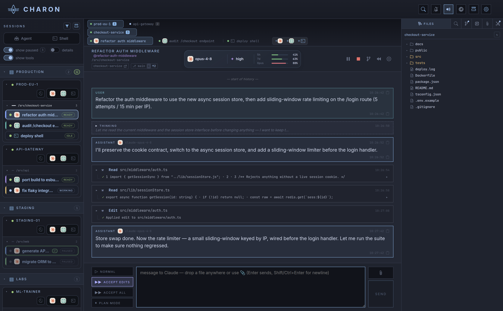</img>
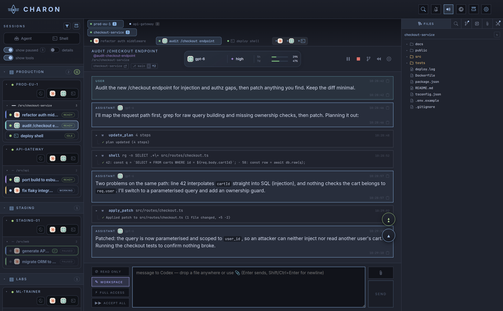</img>

Each session runs **on the VPS**: a `ClaudeSDKClient`, a Codex thread (via the
Codex app-server) or a Cursor SDK agent. Claude and Codex share the controls
below; [Cursor](#cursor-sessions) exposes the subset its SDK supports.

- **Live transcripts.** Streamed answers, collapsible reasoning, tool calls
  paired with results, shell output, plans, patches, images, compaction markers
  and background work. A conversation-only switch hides operational cards.
- **Scheduled tasks.** What a Claude session has scheduled for itself
  (CronCreate, ScheduleWakeup, `/loop`) sits in a bar above the composer, with
  each task's next run and the prompt it will send; an alarm marks a ready
  session that has some, and the turn a task starts opens with its prompt.
- **Approval cards.** Command, file and tool approvals share one card: _allow
  once_, session-scoped approval, _deny_. Defaults are Claude Normal and Codex
  Workspace; an explicit **Accept all** mode skips prompts. Codex adds an
  automatic reviewer, permission profiles and Guardian-denial retry; Claude
  keeps a per-tool "always allow" list. Each card counts down **the provider's
  own deadline**, which survives reloads and reconnects.
- **Full lifecycle.** Create, import, resume, sleep, archive, rename, delete,
  interrupt and force-stop. Every session has a stable `@handle` that renaming
  never breaks.
- **Fork, rewind, compact.** Fork at any visible user turn, within a provider
  or across providers; editing an old prompt forks the same way. Rewind shows
  what will be removed and changes agent history only — **never files**.
  Compact on demand from the context gauge under the session path.
- **Code review** from the Git tab — uncommitted changes, a base branch, a
  commit or custom instructions — inline or in a separate session. Codex uses
  its native review; Claude a read-only review on a native fork.
- **Session edits.** Claude keeps bounded before/after snapshots and can
  restore one file; Codex keeps its unified patches for inspection.
- **Attachments** by drag & drop, 📎 or paste: the file is uploaded into the
  session's working directory and its path inserted into your message. No mime
  filter — the agent decides what it can use.
- **Tools inspector.** Context-window pressure, per-turn usage, effective model,
  MCP servers (health, tools, auth), sub-agent transcripts, background-task
  stop, Claude skills and slash commands, Codex skills and apps.
- **Per-session configuration.** Model, effort, instructions and JSON output
  schema; Claude fallback model, skills, settings scope
  ([details](#which-settings-files-claude-sessions-load)) and environment;
  Codex sandbox, personality, reasoning summary, service tier, provider,
  ephemeral threads and bounded `config.toml`-style overrides.
- **Custom connections.** Point a Claude or Codex session at a compatible
  third-party endpoint (base URL + key); Charon probes its models and tests
  each engine. Credentials are encrypted at rest and never sent to the browser.
- **Accounts.** In-hub sign-in (Claude OAuth code, ChatGPT device code or API
  key for Codex), several account profiles per VPS and provider, and live
  5h/7d quota gauges kept separate from per-turn token totals.
- **New models announce themselves** with a badge on the header and the
  provider's Settings tab.
- **Full-text search** over stored history; the effective model is stamped on
  each answer even when a provider reroutes it.
- **Durable.** Restart Charon, restart the agent, drop the network: the session
  keeps running and the UI replays exactly what it missed.

Controls follow each backend's declared capabilities. Claude alone has fallback
models, exit-plan questions and slash commands; Codex alone has apps,
OAuth-aware MCP servers, native review, permission profiles and the automatic
reviewer.

### Cursor sessions

Cursor is an optional third backend. Enable it in **Settings**, install its SDK
from the VPS agent controls, then open the sign-in link — nothing to paste. The
backend switch also governs SDK installation and automatic updates.

Cursor sessions share the chat, workspace, lifecycle, `@handle` and peer
messaging. The model picker uses the account's catalog and each model's
reasoning parameters; turn usage includes recorded cost, and account usage
opens Cursor's dashboard. Import scans known workspaces with folder selection
and pagination. Cursor has no native fork, rewind, manual compaction,
context-window gauge or file-revert snapshots; cross-provider handoffs and
detached reviews use transcript transfer.

### MCP and session-to-session messaging

**Tools → MCP servers** shows each session's [MCP](https://modelcontextprotocol.io/)
servers with status, tool count, errors and auth state. Claude servers can be
toggled there; Codex servers can start their OAuth flow.

Every live session also gets an internal MCP server, `charon_peer`:

- `list_sessions` — the other live sessions on the same VPS (`@handle`, name,
  provider);
- `send_message` — delivers a message to one exact `@handle` through its normal
  input path.

So _"Ask `@api-review` to inspect this migration and reply with its findings"_
works for any provider:

```
source agent → charon_peer MCP → charon-agent → target session → reply the same way
```

`charon_peer` is a local stdio process routed through the daemon's chmod-600
Unix socket — no port, no external service. Deliveries are recorded as
**external messages**, never forged human prompts. Routing is same-VPS and
live-only, capped at 16 KiB per message and 20 sends per minute per source. A
success means "delivered", not "answered": ask the target to reply.

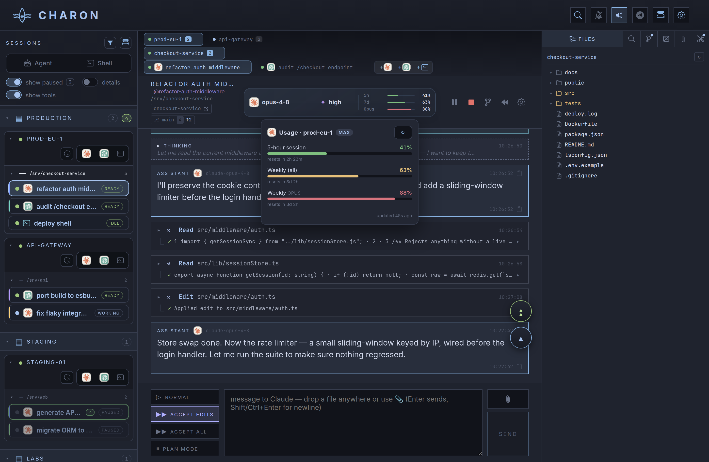</img>

## 2 · A small IDE over SSH — tabs, files, editor, git

Read what the agent wrote, fix a line, commit — without leaving the tab. All of
it rides the same SSH connection.

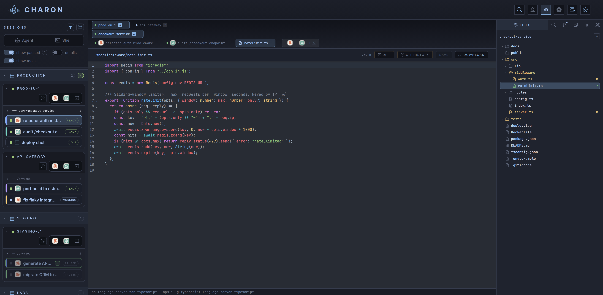

**Tabs.** Grouped **machine → folder → item** (sessions, shells, files, install
logs). Opening is a *preview*; double-clicking or real work **pins** it.
Closing a tab never stops a session. The layout lives in the hub, so phone and
desktop share it; rows drag to reorder.

**Sidebar filter.** `?path=/srv/app` scopes the sidebar to a folder, `?vps=<id>`
to a machine; repeat for several, prefix `!` to exclude. Machine and folder
rules combine with AND; among folders the most specific rule wins
(`?path=!/&path=/srv/app` = only that subtree). The funnel button on the
`SESSIONS` row shows how many hidden sessions are **waiting on you** and builds
the URL — one bookmark per project. The selected session and unhealthy VPSes
are never hidden; tabs are not filtered.

**File explorer**, rooted at the session's working directory: lazy folders,
type icons, symlink markers, **git decorations** folded onto collapsed folders
(ignored files dimmed), and live markers for **files an agent is reading or
writing** (click to jump to that session). Right-click: new file/folder, copy
path, rename, delete, download. Files download streamed through SSH; **folders
download as a ZIP** built on the fly. Project-wide file and content search.

**File manager**: the folder button on a VPS opens that explorer at `/` in its
own tab, with no agent session. In an explorer rooted at `/`, anything outside
`/var/www` asks harder: a delete needs the word typed, a rename or a move warns.

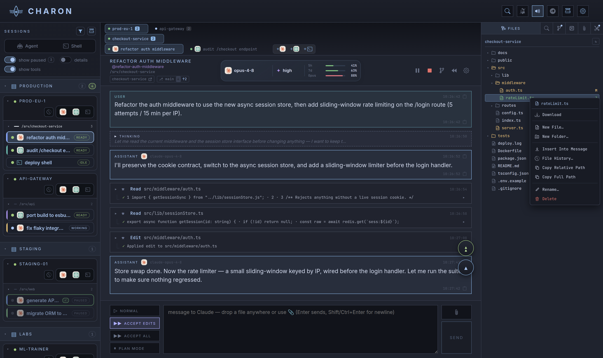</img>

**Code intelligence.** Language servers (`pyright`,
`typescript-language-server`, `gopls`, `rust-analyzer`, `clangd`) run **on the
VPS**, beside the project's dependencies: diagnostics as you type, hover,
go-to-definition (with a picker when there are several), references, rename,
format, symbols. Nothing is auto-installed — a missing server shows its install
command. At most four servers per VPS; idle ones stop.

**Editor.** CodeMirror 6, `Ctrl/Cmd+S`, dirty marker. Saves are **sha-gated**:
if the file changed since you opened it, Charon offers *reload* / *overwrite* /
*keep editing* instead of clobbering. Writes are atomic and keep the file mode.
Images, audio, video and PDFs preview inline; CSV/TSV open as a spreadsheet
grid (rectangular selection copies as TSV); binaries and truncated reads are
read-only.

**Source control**, scoped to the session's repository:

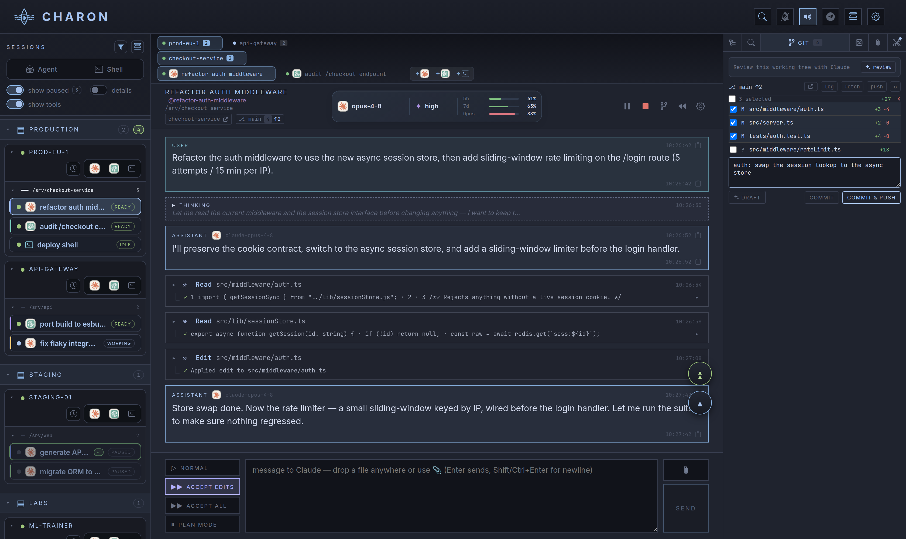</img>
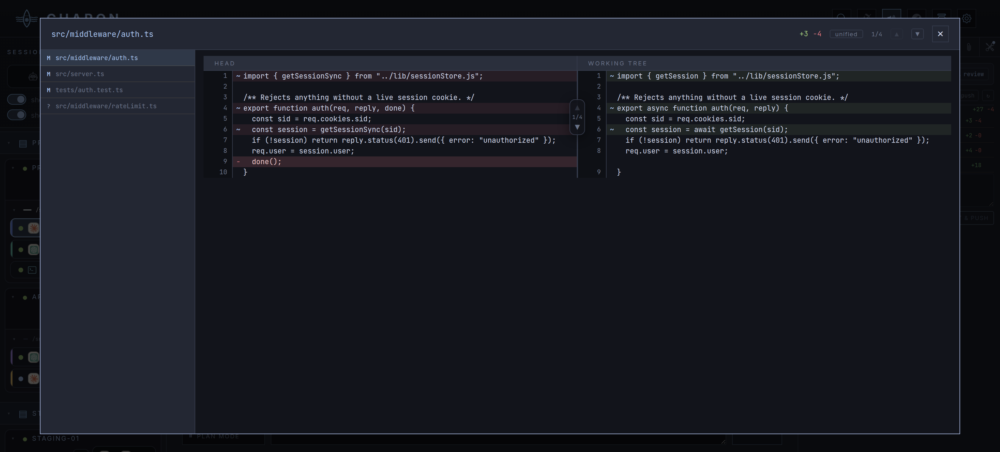</img>

- **Branch chip** beside the working directory (branch, changed files, commits
  to push) and a forge link rebuilt from the remote (GitHub, GitLab, Bitbucket,
  self-hosted).
- **Git panel**: changed files with status and `+/−` counts, per-file diff and
  discard, commit box. **Nothing is pre-selected** and commits are
  **path-scoped**, so you never commit an agent's half-finished work by accident.
- **commit**, **commit & push**, **fetch**, **pull** (`--rebase --autostash`).
  No reset, no force push, no repo-wide discard.
- **Branches**: drift vs upstream and vs the current branch, last commit,
  remote-only branches, worktree locks; switch, create (optional `push -u`),
  delete. A switch is **never forced** — if it would overwrite local changes,
  Charon names the files and HEAD stays put.
- **Folders of projects**: a session on `/srv` finds every checkout below it
  (bounded scan), each with its own section.
- **History** for the repo or one file, paged, in the same diff reader.
- **Side-by-side diffs** (HEAD vs working tree) with explicit hunk gaps and
  ▲/▼ change stepping (Alt+arrows); the raw patch is one click away.
- ✨ **Commit-message draft** from the selected changes and recent subjects —
  runs hub-side on `claude.api_key`, the only button that spends API credit.

Git runs as the agent's user on the VPS with that box's own credentials;
Charon never stores git credentials.

## 3 · Persistent SSH shells

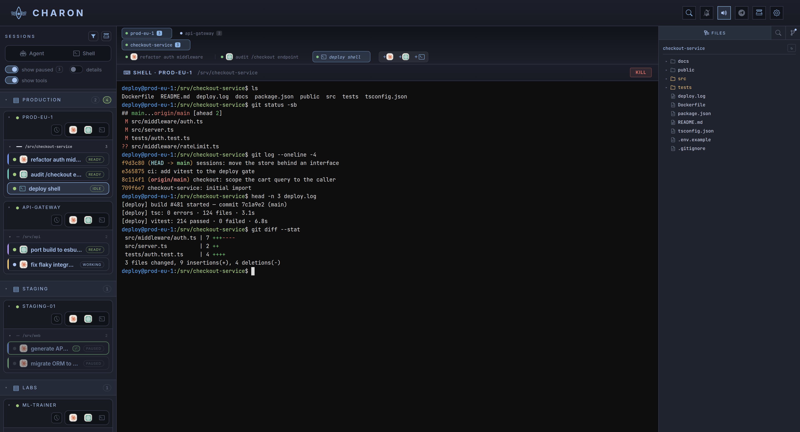

xterm.js terminals, several per VPS, next to your sessions:

- The **PTY + bash live in a detached holder** on the VPS: shells survive hub
  and agent restarts/updates, and scrollback replays from a durable log.
- WebSocket transport, tail replay on reconnect, "finished" notifications,
  last-resize-wins across devices.

## The same UI, on a phone

Same components, responsive breakpoints: sidebar and tool panel become drawers.

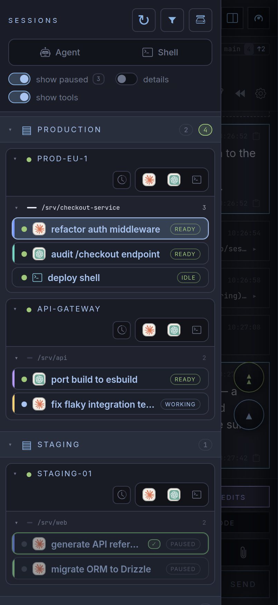</img>
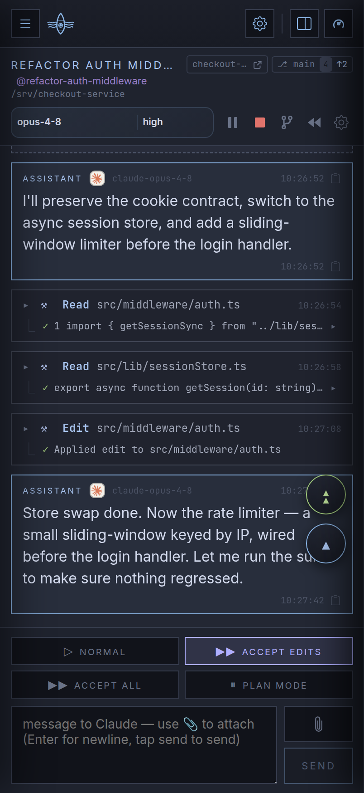</img>
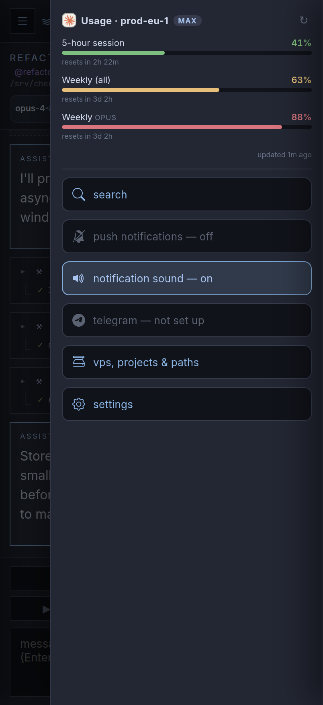</img>

## Themes

**Settings → General → theme**:

| Theme | |
| --- | --- |
| **Nordic Tokyo** | default — deep blue-grey, low glare |
| **Daylight** | light |
| **Etonc** | warm greys and coral, document-style transcript |
| **Cupertino** | light grey chrome, white content, fine borders |
| **Cupertino Night** | the same layout in a dark palette |

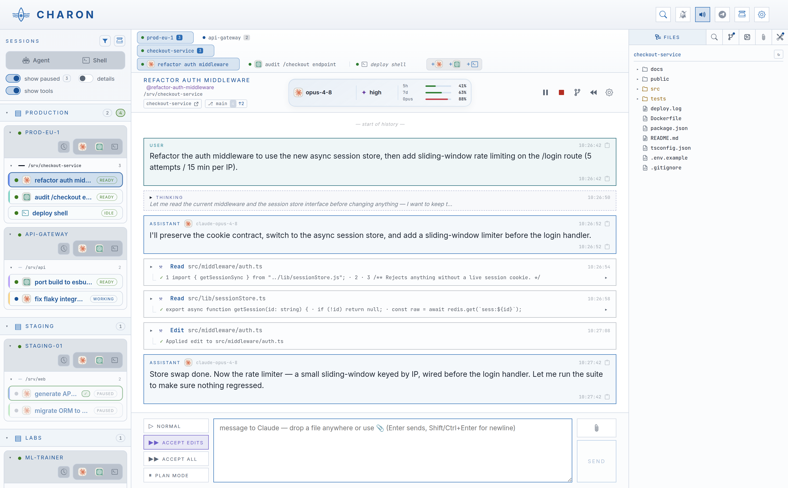</img>
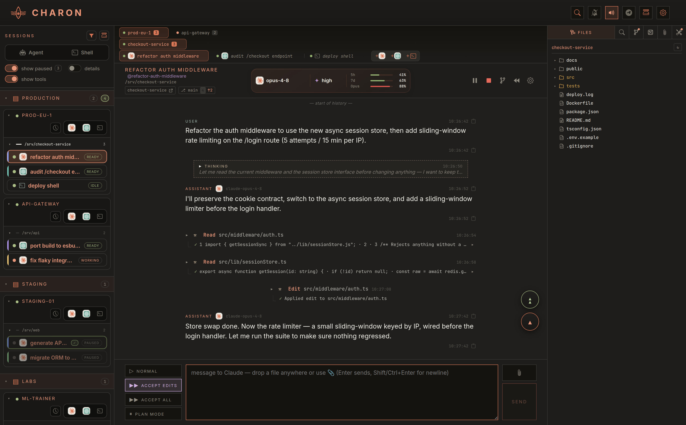</img>
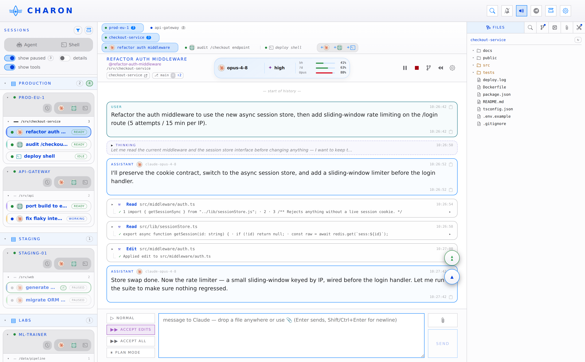</img>
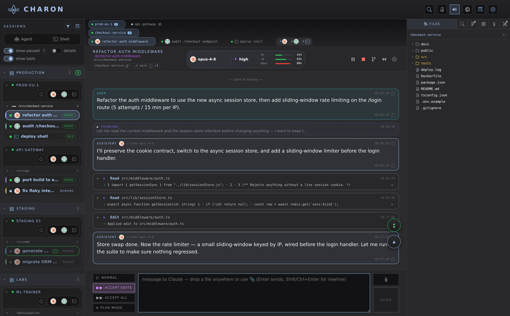</img>

[All five at full size, and how to recapture them](./docs/screenshots.md).

The theme is hub-wide and switches live on every open tab and device. It previews
before you save, renders server-side (no flash on load) and also drives the
terminal palette, the editor highlighting and the phone's browser chrome.

**Adding one** = one token block in `app/themes.css` (`[data-theme='midnight'] {
--bg: …; --text: …; --accent: … }`) plus one entry in `app/themes.ts` (label,
`dark`, `themeColor`, xterm palette). Every colour resolves through semantic
tokens, translucent variants derive via `color-mix`, and `tests/themes.test.ts`
fails CI if a theme misses a token or a stylesheet hard-codes a colour.

---

## Requirements

**Hub:** Node.js ≥ 20, `openssl`, an `ssh` client. SQLite is bundled
(`better-sqlite3`).

**Each VPS:** SSH **by key**, Python ≥ 3.10, and `git` for source control. The
bootstrap installer handles the rest on Ubuntu/Debian (apt), Fedora/RHEL (dnf),
Alpine (apk) and Arch (pacman): a venv with `claude-agent-sdk` and
`openai-codex` (plus `cursor-sdk` when Cursor is enabled), the `claude` CLI for
sign-in, and the agent. A failed backend install is reported without aborting
the others. Sign in only to the backends you use. Other distros are untested;
macOS/Windows/\*BSD VPSes are unsupported.

The agent is deployed and updated by Charon. A VPS running an older agent says
so where a newer feature would be, instead of failing.

## Quickstart

```bash
git clone https://github.com/Lomchat/charon.git
cd charon
cp .env.example .env
# Edit .env:
#   - MASTER_PASSWORD : a strong passphrase (it's your login)
#   - generate three secrets:
#       openssl rand -hex 32   # → MASTER_SALT
#       openssl rand -hex 32   # → SESSION_SECRET
#       openssl rand -hex 32   # → SYNC_TOKEN

npm ci
npm run db:migrate
npm run build
npm start
# → http://127.0.0.1:10556
```

Log in with your `MASTER_PASSWORD`.

### Run with Docker

```bash
git clone https://github.com/Lomchat/charon.git
cd charon
cp .env.example .env          # fill MASTER_PASSWORD + the three secrets as above

# The SSH private key for your fleet goes in ./docker/ssh (any standard name:
# id_ed25519, id_rsa, …). NO passphrase — Charon runs ssh in BatchMode.
install -m 600 ~/.ssh/id_ed25519 docker/ssh/

docker compose up -d --build
# → http://127.0.0.1:10556
```

- `HOST` from `.env` is ignored (compose pins `0.0.0.0`; the `ports:` binding,
  `127.0.0.1:10556`, controls exposure).
- The entrypoint fixes bind-mount ownership, applies migrations, then drops to
  the unprivileged `charon` user (uid 1001).
- The database persists in `./data`, host keys in `./docker/ssh/charon_known_hosts`.

A key mounted **read-only** from elsewhere needs `sudo chown 1001:1001 <key> &&
chmod 600 <key>`; a key with a **non-standard name** needs **Settings → SSH key**
set to `/home/charon/.ssh/<name>`. Both cases warn in `docker compose logs`.

### Adding your first VPS

1. Sidebar → **＋ Agent**: name, IP, SSH user, port, default path.
2. Click **install**. Choose which Claude settings files sessions read
   ([details](#which-settings-files-claude-sessions-load); the default is fine).
   The panel streams each phase (OS, Python, SDKs, CLI, agent, service, ping —
   ~30–90 s on a fresh box). Health chips then show ssh / agent / each provider,
   with the fix for anything not ready.
3. Sign in per backend, no terminal: **claude login** shows an OAuth URL (approve,
   paste the code back); **codex login** shows a ChatGPT device code; Cursor
   opens a link. Logins are per VPS.
4. On the VPS row (or tab bar), **＋** launches a session — pick a working
   directory and send a prompt — or **＋ Shell** opens a terminal.

### Behind a reverse proxy (production)

Charon binds `127.0.0.1:10556`; put a TLS proxy in front. With
`NODE_ENV=production` the cookie is `Secure`, so the proxy **must** serve HTTPS
and forward **SSE** (unbuffered) **and** the WebSocket **Upgrade** for shells.
`GET /api/health` is an unauthenticated probe (200 / 503). nginx:

```nginx
# REQUIRED at the http{} level: without this map $connection_upgrade is empty
# and every shell loops on "reconnecting…".
map $http_upgrade $connection_upgrade {
  default upgrade;
  ''      close;
}

server {
  listen 443 ssl http2;
  server_name charon.example.com;
  ssl_certificate ...; ssl_certificate_key ...;

  location / {
    proxy_pass http://127.0.0.1:10556;
    proxy_http_version 1.1;
    proxy_set_header Host $host;
    proxy_set_header X-Forwarded-Proto $scheme;
    proxy_set_header X-Forwarded-For $proxy_add_x_forwarded_for;
    # WebSocket upgrade (persistent shells)
    proxy_set_header Upgrade $http_upgrade;
    proxy_set_header Connection $connection_upgrade;
    # SSE — no buffering, long timeouts
    proxy_buffering off; proxy_cache off;
    proxy_read_timeout 1h; proxy_send_timeout 1h;
  }
}
```

A systemd unit example: [docs/charon.service.example](./docs/charon.service.example).

### Notifications

**Settings → Notifications** is a table of nine events (session finished,
error, finished with background work running, permission, question, plan,
agent installation, terminal idle, fleet updates) × two independent channels:

- **Web Push** — VAPID keys are generated on first run; click the bell to
  subscribe a browser. Set `VAPID_SUBJECT` (or override in Settings).
  Preferences are **per browser** and still apply when the tab is closed.
- **Telegram** (optional) — a @BotFather bot token and your chat id; hub-wide.
- **Per-session exceptions** from a session's ⚙ or the **Exceptions** list.
- With a **public URL** set, every notification deep-links to its session or shell.

### Which settings files Claude sessions load

| Scope | File | Controlled by |
| --- | --- | --- |
| `user` | `~/.claude/settings.json` | you, on that machine |
| `project` | `<cwd>/.claude/settings.json` | the repository (also loads its `CLAUDE.md`) |
| `local` | `<cwd>/.claude/settings.local.json` | you, for that repo on that machine |

They carry permission rules, hooks, environment variables, skills, subagents and
slash commands. The choice is inherited downwards: **Settings → Claude** (fleet
default, `project`) → **per VPS** (asked at install, editable on the VPS card)
→ **per session** (wizard, *advanced*). Each level can inherit, and *none* loads
no settings file at all, `CLAUDE.md` included.

Enabling `user` can move sessions onto API billing if that file holds an
`apiKeyHelper` or `ANTHROPIC_API_KEY`. `local` lives in the tree the agent
edits, so it is off by default. A change applies to new sessions, and to
existing ones after sleep + resume.

### Optional: an Anthropic API key

`claude.api_key` in **Settings** only powers the ✨ commit-message draft and the
model-catalogue refresh. Without it both show an explicit message.

## Environment variables

| Variable | Required | Description |
| --- | :---: | --- |
| `MASTER_PASSWORD` | yes | Login password, and seed of the AES key encrypting secret settings (see below). Required even with `CHARON_AUTH_REQUIRED=false`. |
| `MASTER_SALT` | yes | scrypt salt, `openssl rand -hex 32`. Secret. |
| `SESSION_SECRET` | yes | HMAC key: the DB stores only `HMAC-SHA256(SESSION_SECRET, token)`. Changing it logs everyone out. `openssl rand -hex 32`. |
| `SYNC_TOKEN` | yes | Bearer token for `POST /api/sync`. `openssl rand -hex 32`. |
| `DATABASE_URL` | no | SQLite path, default `./data/charon.db`. |
| `HOST` / `PORT` | no | Bind address, default `127.0.0.1:10556`. |
| `NODE_ENV` | no | `production` enables HSTS + `Secure` cookies. |
| `VAPID_SUBJECT` | no | Web Push identity (`mailto:`/`https:`), overridable in Settings. |
| `CHARON_INSTANCE` | no | Only when **two** hubs share a VPS: names this hub's agent instance (`~/.charon-<id>`). |
| `CHARON_AUTH_REQUIRED` | no | `false`/`0`/`no`/`off` disables login entirely (see below); anything else keeps it. |
| `CHARON_CLAUDE_SETTING_SOURCES` | no | Initial fleet [settings scope](#which-settings-files-claude-sessions-load) (`user,project,local` or `none`), **applied only on a fresh database**. Default `project`. |

## Architecture

Details and rationale: [`docs/adr-001-charon-agent.md`](./docs/adr-001-charon-agent.md);
contributor map: [`CONTRIBUTING.md`](./CONTRIBUTING.md).

- **Hub** (this repo): Next.js 15 App Router, React 19, SQLite via Drizzle +
  `better-sqlite3`, SSR + one SSE stream per tab. Single process, single user.
- **`charon-agent`**: a stdlib-only Python zipapp at `~/.charon/charon-agent.pyz`
  on each VPS. It listens on a Unix socket and hosts the provider sessions,
  `charon_peer`, detached shell holders and bounded file/search/Git/LSP services.
- **Transport**: one long-lived SSH per VPS running `charon-agent.pyz --connect`
  (stdio ↔ socket). Everything is multiplexed over it — no second connection,
  no agent port.
- **Replay**: every agent event is appended to a durable per-session log with a
  monotonic `seq`; on reconnect the hub replays exactly what it missed, and gaps
  are reported, never silent.
- **Security**: `HttpOnly`/`SameSite=Lax` cookies (`Secure` in prod),
  origin-checked mutations, rate-limited login, `X-Frame-Options: DENY`, HSTS,
  `Referrer-Policy`, `Permissions-Policy` (no CSP: Next inlines SSR scripts).
  File bytes are served from an extension allow-list with `nosniff` and a
  `sandbox` CSP. The agent socket is `chmod 600` and opens no TCP port: your SSH
  key is the authorization boundary.

### About `MASTER_PASSWORD`

It is the login password and, with `MASTER_SALT`, the scrypt seed of the
AES-256-GCM key that encrypts secret settings (Telegram token, Anthropic API
key, Web Push private key, endpoint credentials) as `enc:v1:` blobs.
**Changing either without re-entering those secrets loses them**: decryption
fails closed and they show as unconfigured until re-entered. Transcripts are
not encrypted — treat the DB and its backups as sensitive.

### Running without a password

`CHARON_AUTH_REQUIRED=false` removes login and every session check. Use it only
when the port is already private (loopback + SSH tunnel, VPN, single-user
machine): Charon holds SSH keys to your whole fleet, so an open hub gives root
on every VPS to anyone who can reach it. The CSRF origin check stays on. There
is no in-app toggle, the password is never editable from the UI, and every boot
logs a warning while the hub is open.

### The committed agent `.pyz`

`agent/dist/charon-agent.pyz` is committed because Charon pipes it to each VPS.
After any change under `agent/charon_agent/`, bump `__version__` and run
`bash agent/build.sh` (CI checks both).

## Troubleshooting

| Symptom | Fix |
| --- | --- |
| Blank page, 404 on `/_next/static/*` | Built with `--turbopack` (breaks `next start`; the `build` script never passes it). `rm -rf .next && npm run build`. |
| `next start` loops "Could not find a production build" | A crashed `next dev` polluted `.next`. Same fix. |
| Red dot next to a VPS | Agent not installed/reachable; the health chips name the broken axis and offer the fix. |
| "Agent out of date" / "update the agent" | Click **Update agent** (or let auto-update run while the VPS is quiet). |
| Explorer / git panel: "the agent is not connected" | SSH is down; the health chips give the reason. It reloads when the box returns. |
| Saving says the file changed on the VPS | Someone wrote it after you opened it. Reload or overwrite — explicitly. |
| Shell stuck "reconnecting…" behind a proxy | The proxy doesn't forward the WebSocket `Upgrade`; check the `map $http_upgrade` block above. |
| Docker: port refuses connections but the container is *healthy* | `HOST` was set to loopback inside the container; don't set it — compose pins `0.0.0.0`. |
| Docker: every VPS fails, or `SQLITE_CANTOPEN` | Wrong owner on a bind mount; for a read-only key, `sudo chown 1001:1001 <key> && chmod 600 <key>`. `docker compose logs` names the file. |
| Session stuck on "thinking" | **Force stop** (resumable). |
| Codex: *"already has an active writer"* | Two agent daemons on the box — **Update agent**. |
| `ensurepip is not available` during install | Missing `python3-venv`; auto-installed on apt/dnf — open an issue for other distros. |

`reactStrictMode` is off on purpose (dev double-render duplicates SSE events).
Unsaved editor buffers are per browser; closing a dirty tab warns you.

## Non-goals

- Multi-user, RBAC, SSO — single-user by design.
- VPS provisioning — VPSes must already exist and accept SSH keys.
- Replacing a desktop IDE — no debugger, extensions or multi-file
  search-and-replace UI.
- An exhaustive git client — interactive rebase, force operations and conflict
  resolution belong in the shell.
- Windows / \*BSD / macOS VPS targets; a cloud-hosted version.

## Contributing

Bug reports and PRs welcome: see [CONTRIBUTING.md](./CONTRIBUTING.md) and the
[Code of Conduct](./CODE_OF_CONDUCT.md). Security issues: [SECURITY.md](./SECURITY.md),
not a public issue. Some internal comments are still in French — translation
PRs welcome.

Screenshots use fictitious data; see [docs/screenshots.md](./docs/screenshots.md).

## License

[Apache 2.0](./LICENSE) © Lomchat.
